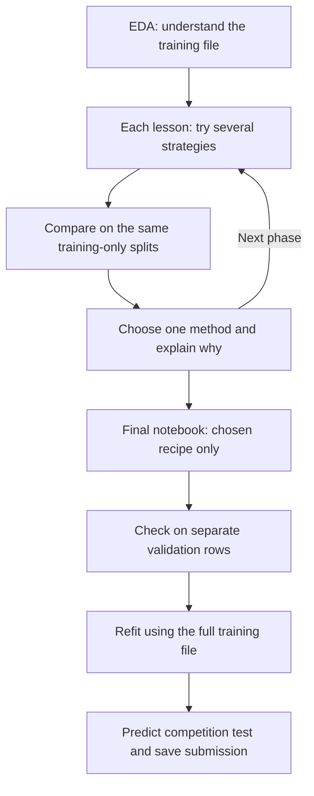

# Penalty Kick Outcome Prediction — A Beginner-Friendly ML Learning Path

An ML learning path built around a [competition I created](https://www.kaggle.com/competitions/penalty-kick-outcome-prediction-challenge). Predict whether a penalty is **scored (1)** or **missed (0)**.

**Complete project:** [16 · Complete ML pipeline](notebooks/16_Complete_ML_Pipeline.ipynb) — one fixed model, validation, and submission, followed by an optional assumption-based cutoff example. No repeated search.

## What makes this beginner-friendly?

Each lesson: detect the problem → apply several strategies → compare on the same splits → explain other alternatives → carry one justified choice forward. Saved outputs come from the revised code's execution, not earlier notebook versions.

## Pipeline

Start with EDA: missing values, duplicates, class counts, distributions, boxplots, and PCA.
Then follow the lessons in order. Every later comparison starts from the earlier chosen steps.



| Data | Source | Purpose |
|---|---|---|
| Training: 16,000 rows | 80% of `train.csv` | Compare methods and choose settings |
| Validation: 4,000 rows | Other 20% of `train.csv` | Check the fixed final recipe |
| Competition test: 6,000 rows | `test.csv` | Predict unknown answers for Kaggle |

Cross-validation rotates hidden groups inside the training part. All learned filling, encoding,
selection, sampling, calibration, and tuning stay inside those training splits. Evaluation rows are never removed or balanced.

### What is actually applied?


| Lesson | Applied here | More alternatives explained |
|---|---|---|
| 01 · EDA | Missing/unique counts, four duplicate rules, class counts, category rates, correlations, histograms, boxplots, PCA, train/test comparisons | What each finding means and which lesson handles it |
| 02 · Baselines and validation | Common-class, always-goal, random, logistic baselines; stratified split and three-fold comparisons | Group/time splits; precision, recall, F1 and accuracy |
| 03 · Missing values and scaling | Drop rows, drop columns, mean/mode, median/mode; no/standard/robust scaling | KNN/iterative filling, missing flags, min–max and log transforms |
| 04 · Encoding | One-hot, grouped one-hot, ordinal, cross-fitted target rates | Frequency, hashing, binary encoding |
| 05 · Feature engineering | 20 candidates; original inputs, three separate groups, all groups together | Binning, polynomial expansion, past-only historical aggregates |
| 06 · Selection | Keep all, ANOVA top 10, L1, forest selection, drop suspected decoys, drop decoys + L1 | Constants, mutual information, correlation, recursive elimination, Boruta |
| 07 · Compression | Keep inputs, PCA, SVD, LDA | Kernel PCA, autoencoders, t-SNE/UMAP maps |
| 08 · Outliers | Boxplots, IQR, physical limits, PCA, scatter; keep, clip, flag, fixed-rule removal, rules + IQR removal, Isolation Forest removal | Z-score, local outlier factor |
| 09 · Imbalance | Original counts, oversampling, undersampling, weights; separate numerical SMOTE experiment | SMOTENC, ADASYN, BorderlineSMOTE, Tomek links, SMOTE–ENN |
| 10 · Models | Logistic regression, decision tree, random forest, extra trees, gradient boosting, RBF SVM, XGBoost, CatBoost | KNN, naive Bayes, neural networks, LightGBM, native CatBoost categories |
| 11 · Tuning | Defaults, manual settings, grid search, random search, eight-trial Optuna/TPE search | More trials, continuous ranges, pruning, successive halving |
| 12 · Ensembles | Single learner, average two, average three, weighted average | Hard voting, bagging, stacking |
| 13 · Probabilities | Original, sigmoid/isotonic calibration, training-selected cutoff | Brier/log loss, recall/cost-based cutoffs |
| 14 · Errors | Confusion matrix, both error types, confident mistakes, subgroups, probability buckets, permutation importance | Partial dependence, error clustering, SHAP |
| 15–16 · Final pipeline | Only the selected recipe, fixed settings, final validation and test predictions | No repeated method searches |


Usually 3–6 strategies are tested in a handling lesson. Feature engineering has **20 explained candidates**, tested as five feature sets.
EDA and error analysis use complementary diagnostics, rather than inventing a winning algorithm.

### Original lesson decisions

| Earlier EDA decision | Choice |
|---|---|
| Exact duplicates | Keep all rows: none found |

| Phase | Chosen in the lesson |
|---|---|
| Missing · 03 | Drop incomplete training rows |
| Scaling · 03 | Robust scaling |
| Encoding · 04 | One-hot |
| Features · 05 | All candidate groups |
| Selection · 06 | Drop suspected decoys + L1 |
| Reduction · 07 | No PCA |
| Outliers · 08 | Add a flag |
| Balancing · 09 | Original class counts |
| Model · 10 | CatBoost |
| Tuning · 11 | Random search |
| Ensemble · 12 | Single model |
| Probabilities · 13 | Original probabilities |
| Decision cutoff · 13 | 0.50 |

Notebook 15 keeps this original recipe. Notebook 16 updates missing-value handling and the cutoff after a training-only comparison: keep and impute incomplete rows, then use cutoff 0.47. A winning step is best in its particular comparison, not a guarantee of the globally best combination; small score gaps may be noise.

## Results

<!-- RESULTS_START -->
Rerun on 15 October 2026. These are the measured model-comparison results from Lesson 10, before tuning and ensembling.

| Model | Cross-validation F1 | Accuracy | ROC-AUC |
|---|---:|---:|---:|
| CatBoost | 0.944 | 0.950 | 0.991 |
| Gradient boosting | 0.942 | 0.948 | 0.990 |
| XGBoost | 0.940 | 0.947 | 0.990 |
| Random forest | 0.927 | 0.935 | 0.984 |
| Extra trees | 0.926 | 0.934 | 0.984 |
| Logistic regression | 0.899 | 0.910 | 0.967 |
| Decision tree | 0.878 | 0.891 | 0.957 |
| RBF support vector machine | 0.872 | 0.886 | 0.957 |

**Original recipe (Notebook 15):** CatBoost with fixed settings `{'learning_rate': 0.1, 'depth': 6}` (chosen in Lesson 11 by random search); single model; original probabilities; cutoff 0.50.

Original recipe on the 4,000-row validation set: **F1 0.9395**, **accuracy 0.9457**, **ROC-AUC 0.9901**. This is not a Kaggle leaderboard score.

**Updated complete pipeline (Notebook 16):** keep and impute incomplete rows; training-selected cutoff **0.47**. On the same validation rows: **F1 0.9414**, **accuracy 0.9470**, **ROC-AUC 0.9905**. These rows have been inspected before, so this is not a fresh independent benchmark. Only changed code was rerun.

Notebook 16 ends with an optional **50% expected-goal-rate example**. It labels the upper half of test probabilities as goals. This is an assumption, not a rate measured from the unlabeled test file or selected by training validation. Use such an adjustment only with a credible, independent reason for the expected rate. Otherwise, keep the training-selected cutoff. This example changes predictions, not the model or its probabilities, and is not ordinary class balancing.

Notebook 16 saves its two prediction files to the ignored `results/pipeline_update/` folder. Both passed 6,000-row, ID-order, and binary-label checks. Validation metrics above describe only the standard training-selected cutoff.
<!-- RESULTS_END -->

Cross-validation scores help choose the model, so the winning search score is optimistic. The separate validation set checks only the chosen pipeline; this is not a Kaggle leaderboard score.
The dataset was explored in earlier project versions. This split protects the rerun's selection procedure; it is not a claim that these rows were never seen historically.

## Learning path

| # | Notebook | Main question |
|---:|---|---|
| 00 | [Learning roadmap](notebooks/00_Learning_Roadmap.ipynb) | How is the course organized? |
| 01 | [Exploratory data analysis](notebooks/01_Exploratory_Data_Analysis.ipynb) | What is in the data, and which issues require later decisions? |
| 02 | [Baselines and validation](notebooks/02_Baselines_and_Validation.ipynb) | What must a useful model beat, and how are scores calculated honestly? |
| 03 | [Missing values and scaling](notebooks/03_Missing_Values_and_Scaling.ipynb) | How should incomplete and differently scaled features be handled? |
| 04 | [Categorical encoding](notebooks/04_Categorical_Encoding.ipynb) | How can text categories become model inputs without leakage? |
| 05 | [Feature engineering](notebooks/05_Feature_Engineering.ipynb) | Which domain relationships can be expressed more clearly? |
| 06 | [Feature selection](notebooks/06_Feature_Selection.ipynb) | Which features contain useful signal, and which may be distractions? |
| 07 | [Dimensionality reduction](notebooks/07_Dimensionality_Reduction.ipynb) | Can many encoded inputs be compressed without losing useful information? |
| 08 | [Outlier handling](notebooks/08_Outlier_Handling.ipynb) | Are unusual observations errors, noise, or informative hard cases? |
| 09 | [Class imbalance](notebooks/09_Class_Imbalance.ipynb) | Can resampling or class weights improve minority-class prediction? |
| 10 | [Model comparison](notebooks/10_Model_Comparison.ipynb) | Which model family best fits this tabular problem? |
| 11 | [Hyperparameter optimization](notebooks/11_Hyperparameter_Optimization.ipynb) | How can model settings be tuned without overfitting validation? |
| 12 | [Ensembling](notebooks/12_Ensembling.ipynb) | Can complementary models improve one another? |
| 13 | [Calibration and thresholds](notebooks/13_Calibration_and_Thresholds.ipynb) | Are probabilities reliable, and should the cutoff remain 0.5? |
| 14 | [Interpretation and error analysis](notebooks/14_Interpretation_and_Error_Analysis.ipynb) | Why does the model make its predictions and mistakes? |
| 15 | [Selected pipeline: short version](notebooks/15_Final_Frozen_Solution.ipynb) | How do the basics fit together? |
| 16 | [Complete ML pipeline](notebooks/16_Complete_ML_Pipeline.ipynb) | How do we run the chosen recipe without repeating the search? |

Lesson comparisons stay within the training part. They are teaching experiments, not independent final performance claims.
Outlier plots flag unusual values; they do not prove errors. Balancing is tested, not assumed helpful for the mild 55/45 imbalance.

## Running the notebooks

The notebooks are self-contained. No generic folder search, ZIP loader, or extra project modules are required.

### Local / VS Code

1. Put `train.csv` and `test.csv` in a `data/` folder at the repository root.
2. Create a virtual environment and install the requirements:

   ```powershell
   python -m venv .venv
   .venv\Scripts\python -m pip install -r requirements.txt
   ```

   The saved run used Python 3.12.14 and the pinned versions in `requirements.txt`.

3. Open a notebook, select that environment, and run all cells. Use `notebooks/` as the working directory.
4. Notebooks 15 and 16 save predictions to the ignored `results/` folder.

### Kaggle

1. Join the competition and accept its rules.
2. Open or import a notebook from this repository.
3. Add the competition data as an input.
4. Change `DATA_DIR` to the path below and run all cells. For exports in 15/16, change `../results` to `/kaggle/working`.

Set the single input folder:

```text
/kaggle/input/competitions/penalty-kick-outcome-prediction-challenge
```

### Colab

Upload `train.csv` and `test.csv` to `/content`; set `DATA_DIR = "/content"`. For exports in 15/16, use `/content` instead of `../results`.

### Extra libraries in hosted runtimes

Lessons 10–16 can use XGBoost/CatBoost; Lesson 11 also uses Optuna. If your Kaggle/Colab kernel does not have them, run this in a new notebook cell before the imports:

```python
%pip install xgboost==3.4.1 catboost==1.2.10 optuna==5.0.0 ipywidgets==8.1.9
```

For local use, install `requirements.txt` inside your virtual environment instead. Native CatBoost category handling is an alternative; these saved comparisons use the same prepared inputs for every model.

## Data and reproducibility

Competition data is not redistributed in this repository. Download it from Kaggle after accepting the competition rules.

The notebooks use fixed seeds and stratified splits (similar goal/miss proportions in each part). Preprocessing, selection, tuning, and resampling stay inside training folds. Hidden competition-test labels are not used.

The complete pipeline keeps 20% of labeled rows for validation; all model choices use the other 80%. Earlier project exploration means a genuinely new dataset is still needed for a stronger generalization claim.

### Validation references

[Scikit-learn: selection versus independent evaluation](https://scikit-learn.org/stable/auto_examples/model_selection/plot_nested_cross_validation_iris.html) · [Imbalanced-learn: resampling leakage](https://imbalanced-learn.org/stable/common_pitfalls.html)


